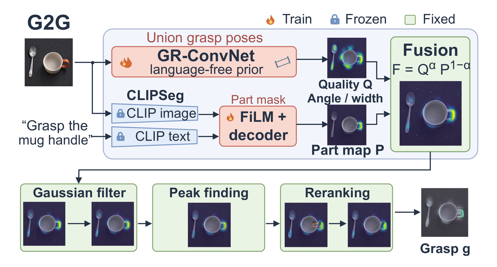
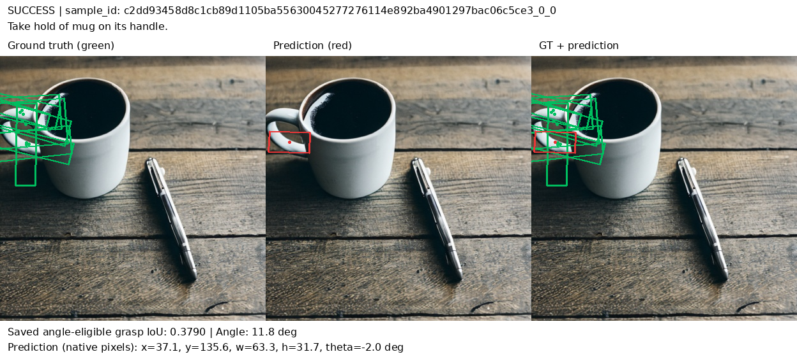
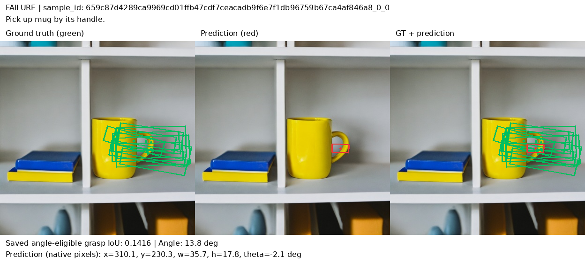
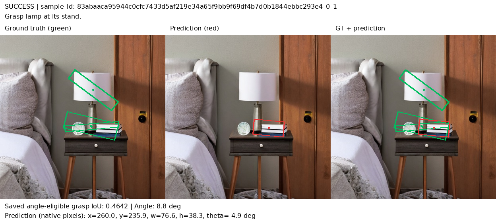
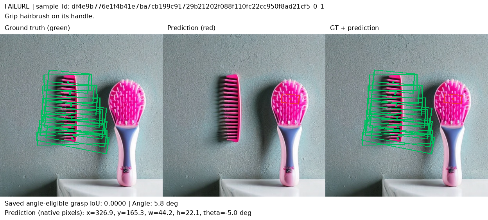

# Ground-then-Grasp (G2G)

Language-driven grasp detection on [Grasp-Anything++](https://github.com/Fsoft-AIC/Grasp-Anything):
given an RGB image and an instruction such as *"Grasp the mug handle"*, predict one
rectangle grasp `g = (x, y, w, h, θ)`.

**Checkpoints:** [huggingface.co/coutMinh/ground-then-grasp](https://huggingface.co/coutMinh/ground-then-grasp)

## Results

| System | Seen | Unseen | H | Pointing S / U |
|---|---|---|---|---|
| Prior only (no text) | 33.6 | 32.3 | 32.9 | 31.2 / 40.3 |
| Mask filter, zero-shot CLIPSeg | 32.0 | 33.3 | 32.7 | 48.0 / 66.4 |
| Mask filter, fine-tuned CLIPSeg | 36.4 | 33.4 | 34.9 | 65.0 / 68.7 |
| Mask peak | 18.4 | 13.8 | 15.8 | 71.9 / 71.4 |
| **G2G (ours)** | **37.6** | **35.8** | **36.7** | 61.0 / 66.4 |
| Oracle: ground-truth part mask + prior *(diagnostic)* | 46.6 | 41.6 | 43.9 | 100 / 100 |
| GR-ConvNet + CLIP † | 37 | 18 | 24 | – |
| LGD † | 48 | 42 | 45 | – |

### Examples

Green: ground-truth grasps for the instruction. Red: our top-1 prediction.

| Seen ✓ *"Take hold of mug on its handle."* | Seen ✗ *"Pick up mug by its handle."* |
|---|---|
|  |  |
| **Unseen ✓** *"Grasp lamp at its stand."* | **Unseen ✗** *"Grip hairbrush on its handle."* |
|  |  |

More examples: [Seen contact sheet](docs/figs/gallery/contact_sheet_seen.png) ·
[Unseen contact sheet](docs/figs/gallery/contact_sheet_unseen.png).

## Reproduce on molab

This project was developed and evaluated on Molab, a free GPU computing platform, using an NVIDIA RTX PRO 6000 Blackwell GPU for acceleration. 

Upload [`notebooks/reproduce_molab.py`](notebooks/reproduce_molab.py) to a GPU molab
session.

